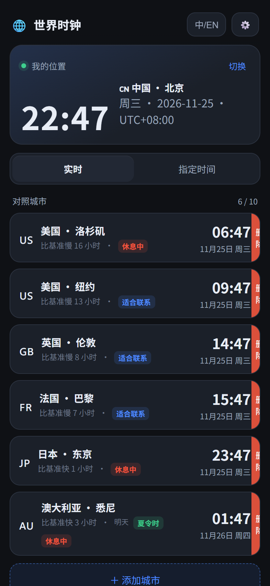
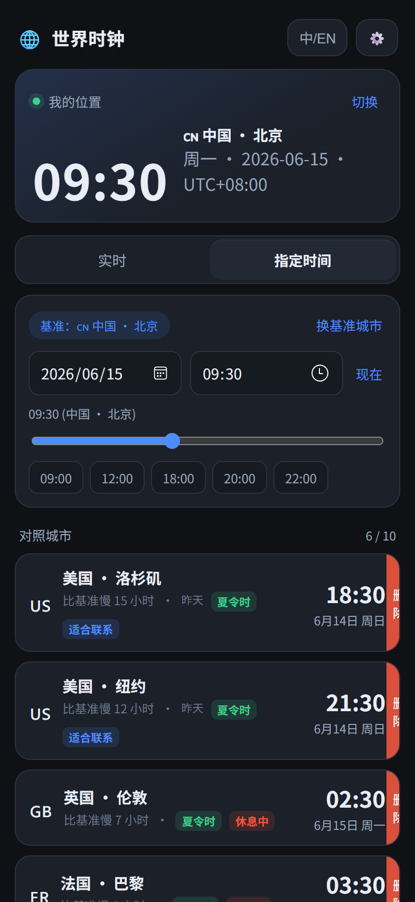
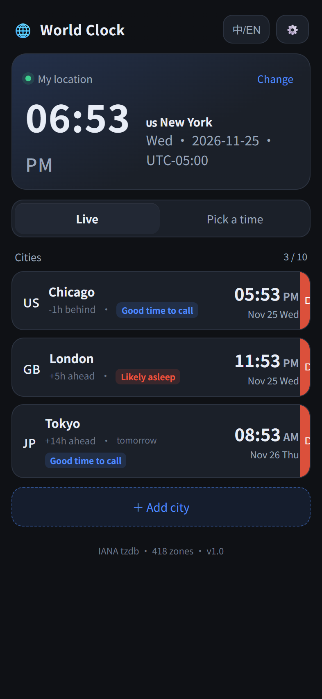
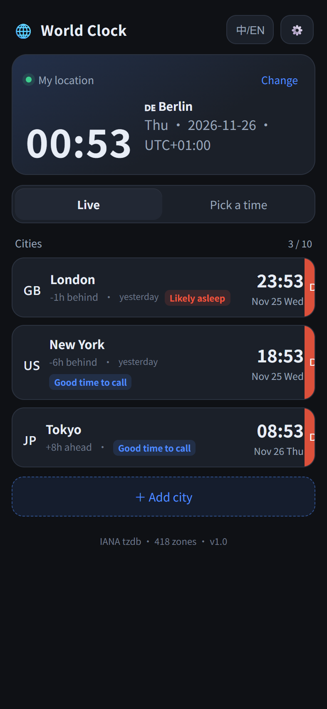

# 世界时钟 · World Clock

按你设定的位置换算世界各地时间。想对照哪个城市由你自己定，夏令时自动处理，418 个时区，**全程离线**：不联网、不收集任何信息、不需要账号。

| | |
|---|---|
| **在线试用 / iPhone 安装** | https://6shmilzyh6.github.io/world-clock/ |
| **国内版网页** | https://6shmilzyh6.github.io/world-clock/app/ |
| **International web app** | https://6shmilzyh6.github.io/world-clock/app-en/ |
| **安卓 APK（国内版）** | [WorldClock-zh-v1.0.0.apk](https://github.com/6shmilzyh6/world-clock/releases/latest/download/WorldClock-zh-v1.0.0.apk) |
| **Android APK (International)** | [WorldClock-Intl-v1.0.0.apk](https://github.com/6shmilzyh6/world-clock/releases/latest/download/WorldClock-Intl-v1.0.0.apk) |
| **单文件 HTML** | [WorldClock-single.html](dist/WorldClock-single.html) — 双击即开，随手发给别人 |

   

## 两个版本

功能完全一样，只是**默认值**不同；两边都能在 App 里随时切语言、改位置、换时间格式。

| | 国内版 | 国际版 |
|---|---|---|
| 包名 | `com.yg.worldclock` | `com.yg.worldclock.intl` |
| 首屏语言 | 中文 | English |
| 我的位置 | 默认北京 | **按设备时区自动识别** |
| 时间格式 | 24 小时制 | 美国 / 英国 / 澳洲 / 印度 / 埃及 / 沙特等默认 12 小时制，其余 24 小时制 |
| 初始对照城市 | 纽约、伦敦、东京 | 本国补 1 处 + 跨洲锚点，自动避开重复 |
| 应用名 | 世界时钟 | World Clock |

包名不同，两个版本可以同时装在一台手机上。

国际版首启动实际验证过 9 个时区（纽约、洛杉矶、柏林、伦敦、东京、悉尼、新德里、圣保罗、开罗）：都正确识别本地时区、正确选 12/24 小时制、初始城市正确；`Asia/Calcutta`、`Europe/Kiev`、`US/Eastern` 这类老时区名也统一折算成现用名。

## 功能

- **位置自己设定** — 点「切换」改「我的位置」；指定时间模式下还能把基准城市单独换成别的城市（比如基准伦敦，看纽约是几点）
- **实时模式** — 一屏看遍所有对照城市当前几点、几号、周几，标注「比基准快/慢几小时」
- **指定时间换算** — 输入任意日期时间，立刻算出每个对照城市的当地时间，跨日自动标「昨天 / 明天」，滑块可按 5 分钟拖动
- **418 个时区** — IANA 完整时区库，含半小时、45 分钟偏移（加德满都 +5:45、查塔姆 +12:45）
- **夏令时自动处理** — 按当天真实 DST 规则计算，纽约、伦敦、悉尼、圣地亚哥等切换日 23/25 小时的边界也正确
- **联系建议** — 按对方当地时间标「适合联系 / 对方可能已休息」
- **城市详情** — 点任意卡片：UTC 偏移、DST 状态、与我的时差、当天逐时对照表（我的时间 → 对方时间）
- **老设备兼容** — Android 5/6 的 WebView 缺 `formatToParts` / `NodeList.forEach` / `Element.closest` 时自动降级，不白屏
- **中英双语**、24/12 小时制、显示秒、深/浅主题、5 套城市预设一键套用、长按删除城市

## 四个版本

| 版本 | 文件 | 适用 |
|---|---|---|
| 安卓 · 国内 | `dist/WorldClock-zh-v1.0.0.apk` | 中文默认，包名 `com.yg.worldclock` |
| 安卓 · 国际 | `dist/WorldClock-Intl-v1.0.0.apk` | 英文默认 + 自动定位，包名 `com.yg.worldclock.intl` |
| 网页版 PWA | `docs/app/`（中）、`docs/app-en/`（英） | iPhone / iPad / 任意浏览器，可「添加到主屏幕」 |
| 单文件 | `dist/WorldClock-single.html`（中）、`dist/WorldClock-single-intl.html`（英） | 一个 HTML 文件，双击即开，不需要服务器 |


两个安卓版包名不同，可以同时装在一台手机上，名字分别是「世界时钟」和「World Clock」。

## 安装

### 安卓

1. 点上面 APK 链接下载（或用数据线 / 微信传到手机）
2. 点击安装，允许「安装未知来源应用」
3. 装完直接打开，图标是蓝底地球 + 时钟

支持 Android 5.0（API 21）到 Android 15+。老设备（Android 5/6）上走降级路径，同样能正常换算。

### iPhone / iPad

Safari 打开 https://6shmilzyh6.github.io/world-clock/app/ → 点分享按钮 → **添加到主屏幕**。之后从桌面图标启动，全屏无地址栏，断网也能用（Service Worker 已缓存全部资源）。

英文界面用 `/app-en/`，安装方式一样。

### 直接发给别人

`dist/WorldClock-single.html`（中文）和 `dist/WorldClock-single-intl.html`（英文）都是自包含 HTML，CSS 和 JS 全部内联，对方用浏览器打开即可，不需要任何服务器。

## 源码结构

```
app/                    前端源码（三份文件，未内联）
  index.html              界面骨架
  style.css               样式（深色 / 浅色）
  engine.js               时区换算引擎（纯函数，无 DOM 依赖，可在 Node 里跑）
  app.js                  交互层（多语言、状态管理、渲染）
android/
  AndroidManifest.xml
  src/com/yg/worldclock/MainActivity.java   WebView 壳 + SharedPreferences 存储桥
  res/                                      图标、主题、字符串
  icon/                                     原始图标（多尺寸 PNG）
docs/                   GitHub Pages 站点（自动生成，勿手改）
  index.html              落地页
  app/                    中文 PWA
  app-en/                 英文 PWA
  img/                    站点图片
tools/
  bundle.js               把 app/ 内联成单文件 HTML
  build_web.js            生成 docs/ 站点（两套 PWA + 落地页）
  make_icon.py            生成全部图标（需要 Pillow）
  check_apk.ps1           校验 APK 元信息与内嵌默认语言
  create_repo.ps1         建仓库（一次性）
build_apk.ps1           安卓打包（aapt2 + javac + d8 + apksigner，不依赖 Gradle）
dist/                   发布产物（APK、单文件 HTML）
screenshots/            截图
test/e2e/               Puppeteer 自动化测试
keystore/               签名密钥（不入库，见下）
```

## 本地构建

需要 Node.js 16+、JDK 17、Android SDK 34（`build-tools;34.0.0` + `platforms;android-34`）。

```powershell
# 1. 前端 → 单文件 HTML（两个区域各一份）
node tools/bundle.js cn      # build/worldclock.html
node tools/bundle.js intl    # build/worldclock-intl.html

# 2. 站点（两套 PWA + 落地页）→ docs/
node tools/build_web.js

# 3. 安卓 APK（两个变体，各自读取对应区域的 HTML）
powershell -NoProfile -ExecutionPolicy Bypass -File build_apk.ps1 -Variant cn
powershell -NoProfile -ExecutionPolicy Bypass -File build_apk.ps1 -Variant intl

# 4. 图标（需要 Pillow）
python tools/make_icon.py
```

打包脚本靠三个环境变量定位工具链，改成你自己的路径即可：

```powershell
# build_apk.ps1 顶部
$Sdk  = "$Root\tools\sdk"
$Jdk  = "$Root\tools\jdk\jdk-17.0.21.1+2"
$BT   = "$Sdk\build-tools\34.0.0"
```

工具链体积约 900 MB，没有入库；用 Android Studio 的 SDK 或者 [cmdline-tools](https://developer.android.com/studio#command-tools) 自己装一份就行。

## 测试

```bash
cd test/e2e
npm install
node run.js                   # 中文版界面回归：换位置、指定时间、加城市、详情、12h、英文、清空
node run_final.js             # 交互细节：基准城市切换、预设套用、滑动删除、桌面/窄屏
node check_intl_locale.js     # 国际版 × 9 个设备时区：自动定位、12/24h、初始城市
node check_cn_locked.js       # 国内版装在美国设备上仍是中文 24h
node check_legacy.js          # 模拟 Android 5/6 内核（删掉 formatToParts / closest / NodeList.forEach）
node shoot.js                 # 生成 screenshots/
```

测试用 Puppeteer 驱动本机 Edge/Chrome，**不需要真机**。已覆盖的边界：

- 上海 2026-06-15 09:30 → 伦敦 02:30（同日）、纽约 21:30（前一天）、东京 10:30
- 上海 2026-06-15 23:30 → 奥克兰 03:30，日期跳成 6/16「明天」
- 纽约 7 月 -04:00 / 1 月 -05:00，DST 判定正确
- 洛杉矶 2026-03-08 15:00 → 23:00，DST 切换日 23 小时的边界正确
- 加德满都 +5:45、查塔姆 +12:45、豪勋爵岛 +10:30/+11:00
- 国际版在纽约/洛杉矶/柏林/伦敦/东京/悉尼/新德里/圣保罗/开罗 9 个时区下默认值均正确
- 老内核（无 `formatToParts`）下降级路径输出与标准路径完全一致
- 320px 窄屏与 1024px 桌面宽度布局
- PWA 断网后仍完整可用

## 地区差异是怎么做的

`app/app.js` 顶部读一个构建期注入的标记：

```js
var BUILD_REGION = (typeof window.WC_BUILD_REGION === 'string') ? window.WC_BUILD_REGION : 'cn';
```

- `bundle.js cn` / `intl` 会在 HTML 里写 `<script>window.WC_BUILD_REGION="intl";</script>`
- `build_apk.ps1 -Variant intl` 打包 `worldclock-intl.html`，`-Variant cn` 打包 `worldclock.html`
- `build_web.js` 给 `docs/app/` 注入 `cn`，给 `docs/app-en/` 注入 `intl`

国际版首启动时用 `Intl.DateTimeFormat().resolvedOptions().timeZone` 定位，再用 `TZ_COUNTRY` 表把时区映射到国家，据此决定 12/24 小时制并挑初始城市。用户一旦手动改过设置，存进 localStorage 的值优先，构建默认值不再覆盖。


## 签名

APK 用 PKCS12 keystore 签名，v1 / v2 / v3 三种方案全部启用并通过 `apksigner verify`。

**密钥不在仓库里**（`.gitignore` 已排除 `keystore/`）。原因很直接：公开仓库放签名私钥，任何人都能用你的身份签发「同包名」的伪造更新。

发布新版本时用同一个 keystore 签名，否则老用户无法覆盖安装，只能卸载重装。自己维护时请把 `keystore/worldclock.keystore` 备份到安全的地方（密码在本地记着）。

## 技术要点

- 时区换算全部走 `Intl.DateTimeFormat` 的 `formatToParts()`
- 没有 `formatToParts` 的老内核（Chrome < 57，即 Android 5/6 原生 WebView）走 `format()` 正则解析的降级路径，输出与标准路径一致
- `wallTimeToDate()` 做「墙上时间 → 真实时刻」的双次迭代，正确处理 DST 切换当天不存在的 02:30 和重复出现的 01:30
- 时区有效性做缓存校验（`isValidTz`），老设备缺某个时区时自动降级到 UTC，不会白屏
- 时区别名统一折算（`canonTz`）：`Asia/Calcutta`→`Asia/Kolkata`、`Europe/Kiev`→`Europe/Kyiv`、`US/Eastern`→`America/New_York` 等，避免系统返回老名字时查不到城市
- Android 侧对 `file://` 下的 localStorage 做了 SharedPreferences 兜底——WebView 在 `file://` 协议下 localStorage 有时不持久
- 整个 App 只有 209 KB，因为逻辑全在 77 KB 的 HTML 里，原生层只负责开窗和存储桥

## License

MIT
